<p align="center">
  <picture>
    <source media="(prefers-color-scheme: dark)" srcset="brand/gaskiya-logo-dark.svg">
    
  </picture>
</p>

<h1 align="center">Gaskiyya</h1>

<p align="center">
  <picture>
    <source media="(prefers-color-scheme: dark)" srcset="brand/tagline-dark.svg">
    
  </picture>
</p>

<p align="center">Gaskiyya lets customers check any SMS, link or call against their bank's own records in seconds.<br>One API call when the bank sends. Nothing changes in its messages.</p>

<p align="center"><a href="https://gaskiyya-io.web.app/"><strong>View the live site</strong></a></p>

<p align="center">
  <a href="https://gaskiyya-io.web.app/console/">DemoBank simulation</a> ·
  <a href="https://gaskiyya-io.web.app/banks.html">Integration guide</a> ·
  <a href="https://github.com/gaskiyya/gaskiyya-sdk">Bank SDK</a> ·
  <a href="https://gaskiyya-io.web.app/gaskiyya-whitepaper.pdf">Whitepaper (PDF)</a>
</p>

<p align="center">
  <a href="https://gaskiyya-io.web.app/video/gaskiyya-showcase.mp4"></a>
  <br>
  <sub>Gaskiyya in one minute. Click to watch with sound.</sub>
</p>

<div align="center">

<table>
  <tr>
    <td align="center">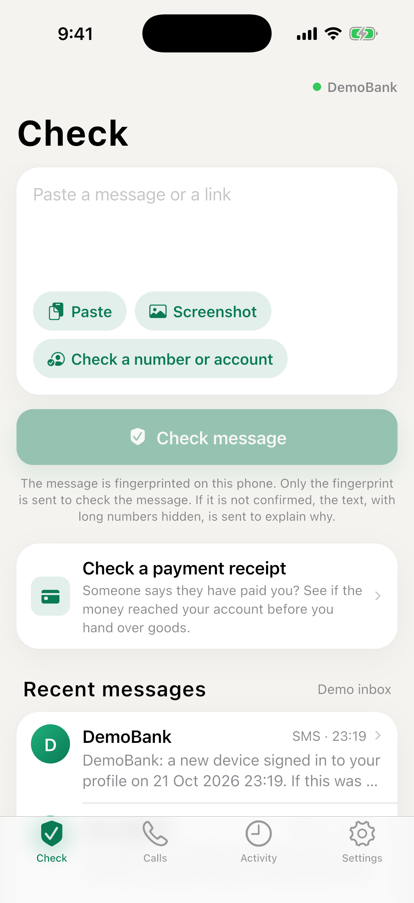<br><sub>Check a message</sub></td>
    <td align="center">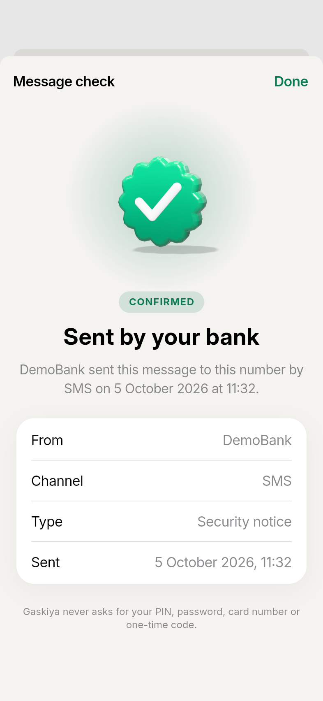<br><sub>Sent by your bank</sub></td>
    <td align="center">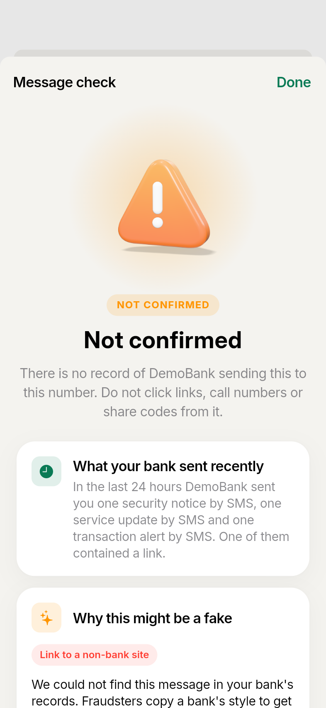<br><sub>Not confirmed</sub></td>
  </tr>
  <tr>
    <td align="center">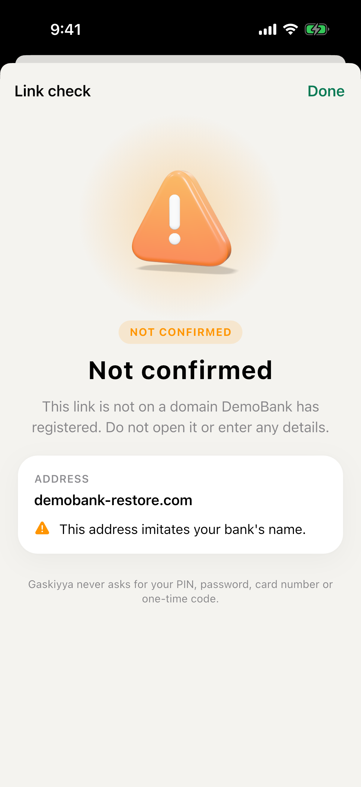<br><sub>Check a link</sub></td>
    <td align="center">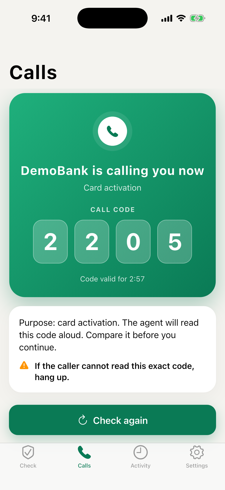<br><sub>Know who is calling</sub></td>
    <td align="center">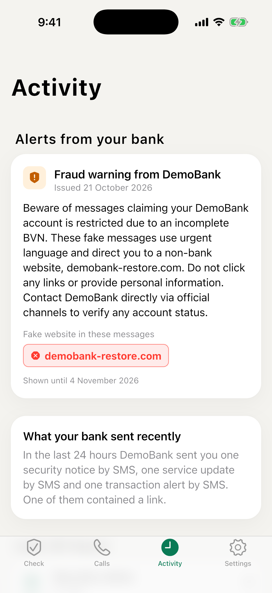<br><sub>Scam warnings from your bank</sub></td>
  </tr>
</table>

</div>

## Try it as DemoBank

Open the DemoBank simulation at **[gaskiyya-io.web.app/console](https://gaskiyya-io.web.app/console/)**. You play the bank on the left, and a customer's phone sits on the right, with the Gaskiyya app on it. Everything runs in your browser with the registry's own code, so nothing is sent anywhere, and reloading the page starts fresh.

<p align="center">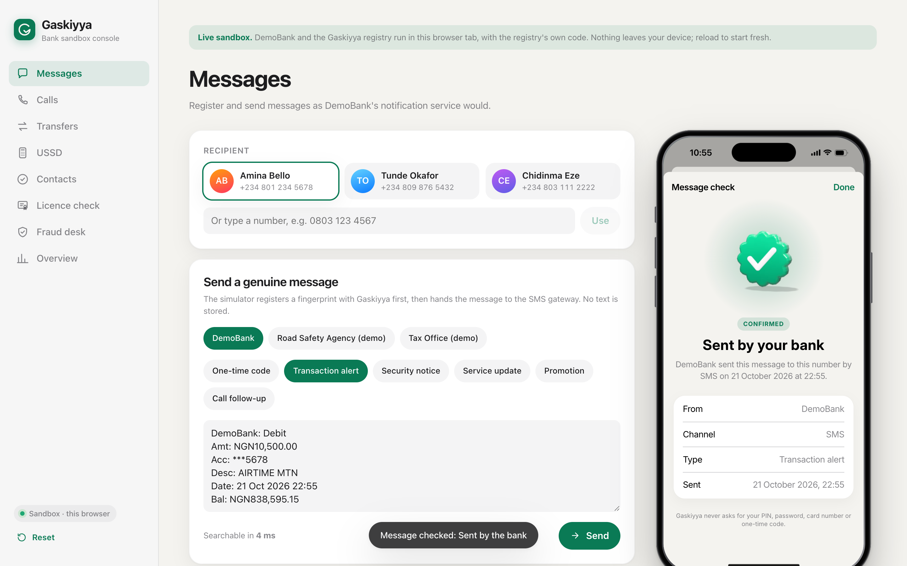</p>

What you can try:

- **Messages.** Send a genuine alert, then a tampered copy or a fake. Open Gaskiyya on the phone, sign in as Amina, and check each one.
- **Calls.** Announce a call and watch the same four-digit code appear on the agent screen and the phone. Then let a fraudster call from the bank's number, and see Gaskiyya say the bank isn't calling.
- **SIM swap.** Move a customer's number to a new SIM and see the bank hold the one-time code.
- **Transfers.** Pay a merchant, then check the receipt, a changed amount and a made-up one.
- **Fraud desk.** Simulate customer reports, run the agent and approve the advisory it drafts.
- **USSD, contacts and licences.** Use the feature phone menu, check a fake customer care number, and ask whether a lender is licensed.

## The problem

A fake looks exactly like the real thing. Fraudsters copy a bank's wording, its sender name and its tone. Often the only difference is a single character.

| Your bank | A fraudster |
| --- | --- |
| `www.demobank.ng/app` | `www.demo-bank.ng/app` |

Customers can't be expected to spot that. The bank's own records can, once every message is registered with Gaskiyya.

## How customers check

One question, a straight answer. Customers check inside their bank's own app through the Gaskiyya API, or in the Gaskiyya app. Either way, the answer comes from the bank's records.

1. **Paste it, share it, or snap it.** Copy a suspicious SMS or WhatsApp message, share it straight from your messages app, paste a link, or send a screenshot.
2. **Fingerprinted on your phone.** Gaskiyya turns the message into a fingerprint on your phone. Only the fingerprint decides the result, never your words. To explain a result that is not confirmed, the text is sent once with long numbers hidden.
3. **Your bank's records answer.** If your bank sent that exact message to your number, you'll see *Sent by your bank*, with the channel, date and time.
4. **Not on record? You'll know why.** You'll see what your bank really sent you recently, and plain-language reasons the message looks like a scam.

Change one character and the check fails. Extra spaces don't matter. A changed letter, digit or dot does. The check is also tied to your phone number, so a real message forwarded to someone else will not verify for them.

## Calls

A code only your bank can read to you. Caller ID can be faked. This can't. When your bank calls, Gaskiyya shows you a four-digit code at the same moment it appears on the agent's screen. If the caller can't read it, hang up.

- The notice arrives the instant the bank dials.
- The code expires after three minutes.
- No call on record? Gaskiyya tells you the bank isn't calling.

## The app

- **Check any link.** Lookalike addresses, shortened links and disguised characters are caught. Only your bank's registered domains pass.
- **Know why it's fake.** Plain-language reasons, from urgent threats to links that aren't your bank's.
- **Never asks for secrets.** No PIN, password, card number or one-time code. Ever. If something asks, it isn't us.
- **See what your bank really sent.** Your bank's recent messages to you, at a glance. Counts and types only, never the text.
- **Easy to read, day or night.** Follows your phone's light or dark setting.
- **Know who is calling.** When your bank calls, the app says so. When it isn't calling, the app says that too.

## Privacy

Built so there's nothing to leak.

- **Your words stay on your phone.** Messages are fingerprinted on your device. The text is never sent or stored.
- **No phone numbers stored.** Records hold scrambled keys only. Even a breach reveals no numbers and no messages.
- **Only your bank confirms.** An answer of "sent by your bank" comes from an exact match in your bank's records, never from a guess or an AI.
- **When in doubt, it says so.** If a check can't be completed, you're told plainly. Gaskiyya never guesses "genuine".

## For banks

One API call. Fewer customers fooled.

Register a fingerprint when you send. Announce calls before you dial. Customers verify in your app through the Gaskiyya API, or in the Gaskiyya app. No access to core banking, accounts or transactions. Run it in your own cloud, or ours.

1. **Register as you send.** One call per message, with the fingerprint of its final text.

   ```http
   POST /v1/messages
   { "recipient": "+234801...", "contentDigest": "3f37d7...", "category": "transaction_alert" }
   ```

2. **Announce outbound calls.** Your dialler opens a session, and the agent reads the four-digit code from their screen.
3. **See campaigns as they start.** Customer reports are grouped into scam campaigns with a drafted advisory, sent to your fraud desk by email.

The quickest way to connect is the Node.js SDK, which has its own repository: [gaskiyya/gaskiyya-sdk](https://github.com/gaskiyya/gaskiyya-sdk). It gets the access token, works out fingerprints the same way the registry does, and retries safely.

```ts
import { Gaskiyya } from '@gaskiyya/bank-sdk';

const gaskiyya = Gaskiyya.fromEnv();

await gaskiyya.messages.register({
  recipient: '+2348012345678',
  text: smsText,
  category: 'transaction_alert',
});

const call = await gaskiyya.calls.open({
  recipient: '+2348012345678',
  purpose: 'fraud_check',
  agentRef: 'agent-017',
});
```

To see it all from the bank's side first, [try it as DemoBank](#try-it-as-demobank). The full technical documentation follows. It is the same as the [integration guide](https://gaskiyya-io.web.app/banks.html) on the website.

**Contents:** [What you connect](#what-you-connect), [From agreement to production](#from-agreement-to-production), [Where Gaskiyya sits](#where-gaskiyya-sits), [Register every message](#register-every-message), [The fingerprint](#the-fingerprint), [Announce calls before you dial](#announce-calls-before-you-dial), [Check the SIM before you send a code](#check-the-sim-before-you-send-a-code), [Sign customer tokens](#sign-customer-tokens), [Register transfer receipts](#register-transfer-receipts), [Give your fraud desk the campaigns](#give-your-fraud-desk-the-campaigns), [How a verdict is decided](#how-a-verdict-is-decided), [Security requirements](#security-requirements), [Run it in your cloud, or ours](#run-it-in-your-cloud-or-ours), [Bank-facing API](#bank-facing-api), [Customer verification API](#customer-verification-api), [Onboarding checklist](#onboarding-checklist)

### What you connect

Gaskiyya is infrastructure: it connects only where your bank sends communications. It never reads balances, accounts or transactions, and needs no open banking API. Your customers verify in your own app through the customer API, or in the Gaskiyya app.

#### Notification service

Where: the code that hands SMS and WhatsApp messages to your gateway

Compute a fingerprint of the final text and register it with the recipient's number. The message itself goes out unchanged.

#### Contact centre

Where: the dialler and the agent desktop

Announce each outbound call before dialling. Show the returned four-digit code on the agent's screen.

#### Mobile banking backend

Where: the service behind your app's login

Sign a short-lived token naming the customer's phone number. Publish your public keys at a stable URL.

#### Fraud desk

Where: your fraud and security team

Receive alerts when customers report the same scam. Approve or dismiss each campaign's drafted advisory.

### From agreement to production

Five stages. A pilot enrols one message type for a small group of customers, measures coverage, then expands.

<p align="center">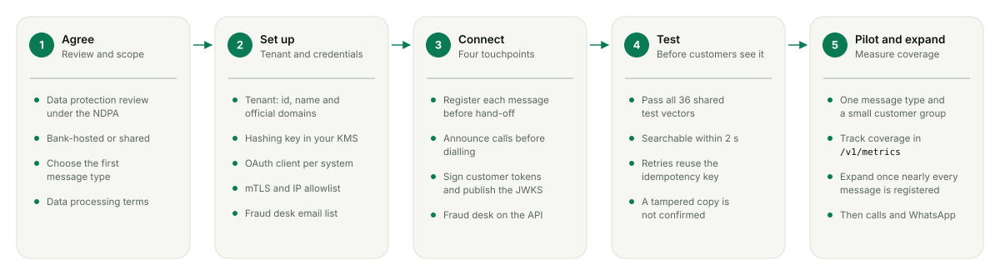</p>

<p align="center"><sub><b>Integration workflow.</b> Every stage has a clear exit: the review is signed, the credentials work, the four touchpoints are live, the tests pass, and coverage is high enough to expand.</sub></p>

### Where Gaskiyya sits

Beside your systems, never in their path. Your gateway delivers every message exactly as it does today; Gaskiyya only holds a keyed fingerprint of it.

<p align="center">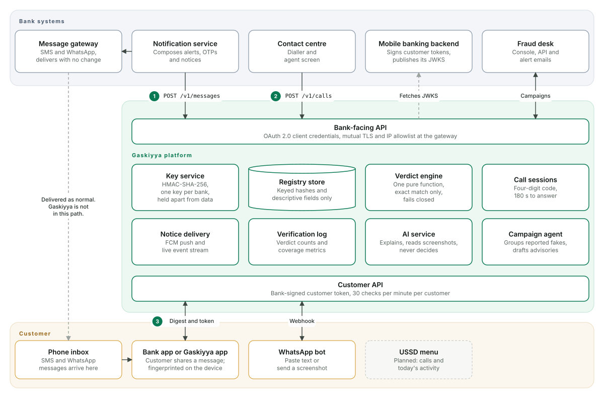</p>

<p align="center"><sub><b>System architecture.</b> Bank systems call the bank-facing API. Customer channels call the customer API. Numbers mark the three calls that matter most.</sub></p>

### Register every message

Before or alongside hand-off to your gateway, send the fingerprint of the final text with the recipient's number. Registration runs in the background and never delays a message.

<p align="center">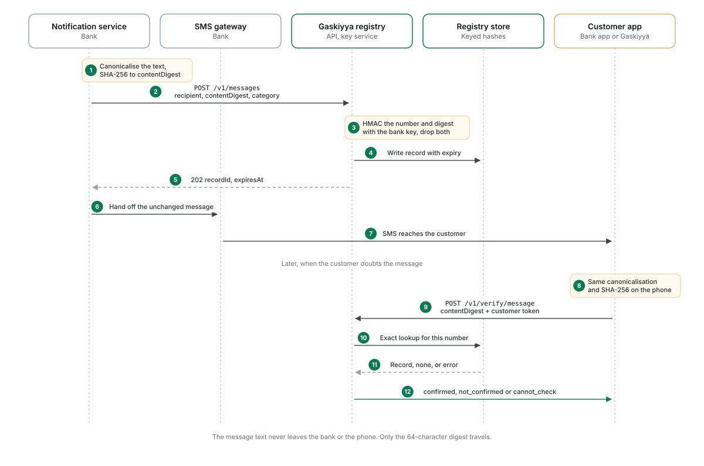</p>

<p align="center"><sub><b>Registration and verification.</b> The customer's phone computes the same fingerprint and asks whether you registered it for their number.</sub></p>

#### Choose a registration pattern

<p align="center">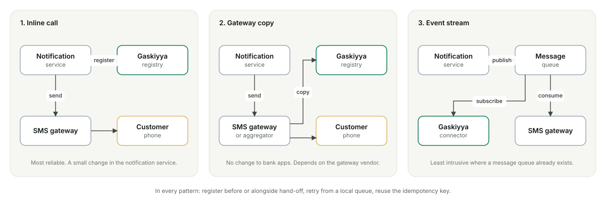</p>

<p align="center"><sub><b>Three patterns.</b> Pick the one your bank can change most easily. Inline is the most reliable.</sub></p>

#### Get an access token, then register

```sh
# 1. Exchange client credentials for a 10-minute access token
#    200 { "access_token": "...", "token_type": "Bearer", "expires_in": 600 }
curl -s "$GASKIYYA_URL/v1/oauth/token" \
  -H 'content-type: application/json' \
  -d '{"grant_type":"client_credentials","client_id":"notify-svc","client_secret":"'"$CLIENT_SECRET"'"}'

# 2. Register the message you are about to send. contentDigest is the
#    fingerprint of its final text, here "DemoBank: Debit\nAmt: NGN5,000.00\nAcc: ***5678"
curl -s "$GASKIYYA_URL/v1/messages" \
  -H "authorization: Bearer $ACCESS_TOKEN" \
  -H 'content-type: application/json' \
  -H 'idempotency-key: alert-7f3c9a' \
  -d '{
    "recipient": "+2348012345678",
    "channel": "sms",
    "contentDigest": "2c0c122ad56268258bb16e6ba85fb2f9c8bab9ce1d8ff20527060f8c3151729f",
    "category": "transaction_alert",
    "hasLink": false,
    "linkDomains": [],
    "asksCallback": false,
    "sentAt": "2026-10-20T13:02:11Z"
  }'

# 202 Accepted (200 when the idempotency key was seen before)
# { "recordId": "rec_...", "expiresAt": "2026-11-19T13:02:11.000Z" }
```

#### Rules for the registration path

- **Never block sending.** Register from a local retry queue; the message goes out regardless.
- **Hash exactly what is sent.** Compute the digest from the final text handed to the gateway, after templating.
- **Make retries safe.** Send an `Idempotency-Key` of up to 128 characters. A repeat returns the original record.
- **Be fast.** Aim for under two seconds from send to searchable record.
- **Batch when it helps.** `POST /v1/messages/batch` takes up to 500 messages; the idempotency key is suffixed with each position.

| Field | Rule |
| --- | --- |
| `recipient` | E.164 phone number the message is sent to |
| `channel` | `sms`, `whatsapp`, `email` or `push` |
| `contentDigest` | SHA-256 of the canonical text, 64 lowercase hex characters |
| `category` | `otp`, `transaction_alert`, `security_notice`, `service_update`, `marketing` or `call_follow_up` |
| `hasLink`, `linkDomains` | Whether the text has a link, and up to 10 of its domains |
| `asksCallback` | Whether the text asks the customer to call a number |
| `sentAt` | ISO 8601 time with offset. Records expire 30 days later by default. Refused if more than 5 minutes ahead of the registry's clock, or already older than the expiry |

### The fingerprint

Your connector and the customer's phone must produce the same digest for the same text. Four steps, in this exact order, then SHA-256.

1. Remove zero-width characters: U+200B, U+200C, U+200D, U+2060 and U+FEFF.
1. Apply Unicode NFKC normalisation as defined by Unicode 15.1. A code point not assigned in 15.1 is kept unchanged, and the text on each side of it is normalised separately.
1. Collapse every whitespace run to one space. The set is explicit: tab, line feed, vertical tab, form feed, carriage return, space, U+0085, U+00A0, U+1680, U+2000 to U+200A, U+2028, U+2029, U+202F, U+205F and U+3000.
1. Trim spaces at both ends. Keep letter case and punctuation.

<p align="center">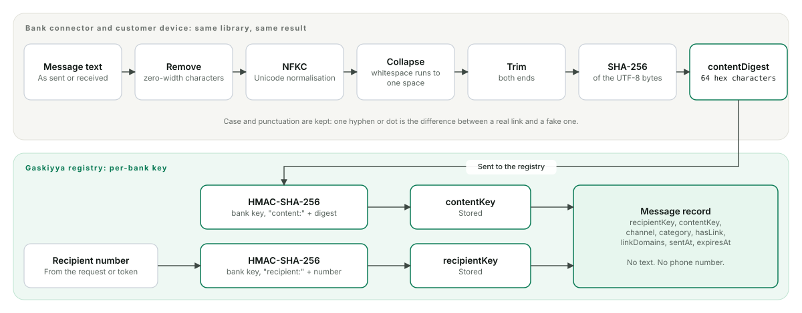</p>

<p align="center"><sub><b>From message to stored record.</b> Gaskiyya keys the digest and the number with your bank's secret, and stores neither.</sub></p>

```ts
// Node.js, with the Gaskiyya bank SDK (no credentials needed for hashing)
import { contentDigest } from '@gaskiyya/bank-sdk/hashing';

const digest = contentDigest(finalSmsText); // 64 lowercase hex characters
```

The Node.js SDK implements the fingerprint for banks; the Gaskiyya apps use the same rules in Dart. In any other language, implement the four steps and pass every shared test vector (`tests/fixtures/vectors.json` in the SDK repository) before going live.

### Announce calls before you dial

Caller ID can be spoofed, so Gaskiyya ignores it. Your dialler opens a session, the customer's app shows a four-digit code, and your agent reads the same code from their screen.

<p align="center">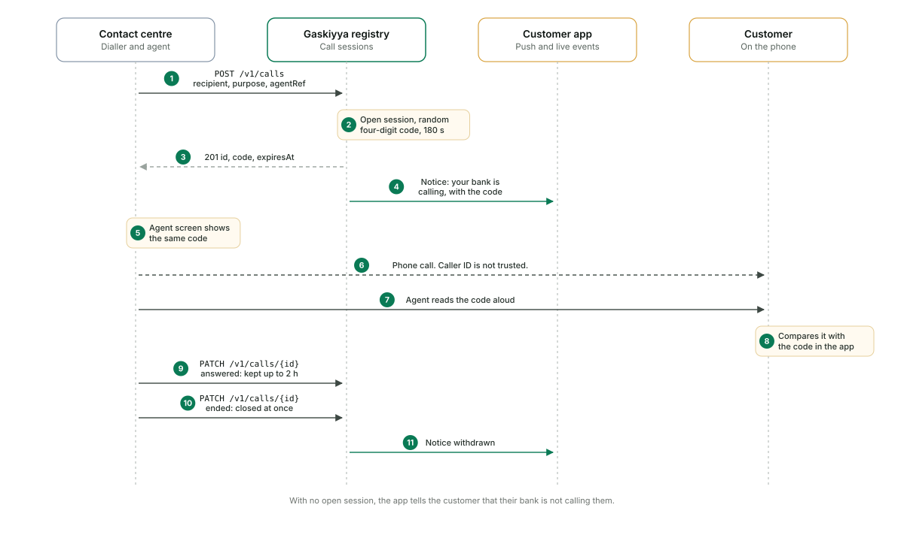</p>

<p align="center"><sub><b>Call verification.</b> A session lasts 180 seconds unanswered. Once answered it is kept for up to two hours; ending the call closes it at once.</sub></p>

```sh
curl -s "$GASKIYYA_URL/v1/calls" \
  -H "authorization: Bearer $ACCESS_TOKEN" -H 'content-type: application/json' \
  -d '{"recipient":"+2348012345678","purpose":"card_activation","agentRef":"agent-017"}'
# 201 { "id": "call_...", "code": "4821", "status": "open", "expiresAt": "..." }

curl -s -X PATCH "$GASKIYYA_URL/v1/calls/call_..." \
  -H "authorization: Bearer $ACCESS_TOKEN" -H 'content-type: application/json' \
  -d '{"status":"answered"}'   # later: {"status":"ended"}
```

- **Show the code to the agent.** A small panel in the agent desktop is enough.
- **Purposes are fixed:** `card_activation`, `fraud_check`, `loan_follow_up`, `account_update`, `service_follow_up`.
- **Close the session.** Mark it `ended` when the call ends so the notice disappears from the customer's phone.

### Check the SIM before you send a code

A fraudster who moves a customer's number to a new SIM receives that customer's one-time codes. Mobile networks report when a number's SIM last changed through the GSMA Open Gateway (CAMARA) SIM Swap API. Gaskiyya asks for you, with one credential for every network it is connected to.

```sh
curl -s "$GASKIYYA_URL/v1/sim-swap/check" \
  -H "authorization: Bearer $ACCESS_TOKEN" -H 'content-type: application/json' \
  -d '{"phone":"+2348012345678","maxAgeHours":72}'
# 200 { "status": "swapped", "swapped": true, "latestSimChange": "...", ... }
# 200 { "status": "unknown", "reason": "provider_unavailable", ... }  -> treat as risky
```

- **Ask before a one-time code or a large transfer.** Hold the code, or step up to another check, when `status` is `swapped`.
- **Unknown is not "no swap".** When the network cannot answer, the status is `unknown`, never `not_swapped`. Treat it as risky.
- **Registration still succeeds.** When you register a one-time code (`category: "otp"`) to a number whose SIM changed recently, the response carries `simSwapWarning: true` so your gateway can hold the code. Nothing the customer sees changes.
- **Customers see it too.** A customer whose SIM changed recently gets a warning beside the verdict, which it never changes, and your fraud desk gets an email that names the customer by a keyed reference, never by number.

### Sign customer tokens

You stay the only party that authenticates your customers. Your backend signs a token that names the customer's number; Gaskiyya checks it against your published keys and nothing else.

<p align="center">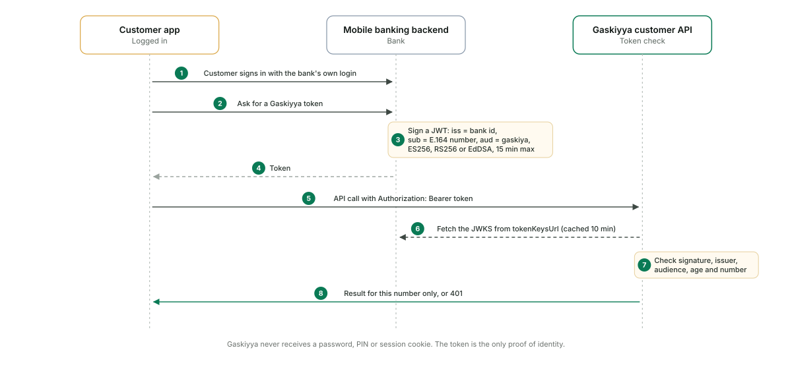</p>

<p align="center"><sub><b>Customer identity.</b> Gaskiyya never receives a password, PIN or session cookie.</sub></p>

| Claim | Value |
| --- | --- |
| `iss` | Your tenant id in Gaskiyya |
| `sub` | The customer's number in E.164 form, for example `+2348012345678` |
| `aud` | `gaskiya` |
| `iat` | Required. Tokens issued more than 15 minutes ago are refused |
| `exp` | Recommended, at most 15 minutes after `iat` |
| `accts` | Optional. The customer's own 10-digit account numbers with you, for example `["0123456789"]`. Only these accounts can be named in a transfer-receipt check; leave it out and your customers get no receipt checks. Gaskiyya never stores them |
| Algorithm | ES256, RS256 or EdDSA, with a key from your JWKS |

```ts
// Node.js with the jose library, in your mobile banking backend
import { SignJWT } from 'jose';

const token = await new SignJWT({})
  .setProtectedHeader({ alg: 'ES256', kid: 'bank-2026-10' })
  .setIssuer('demobank')            // your tenant id
  .setSubject('+2348012345678')     // the logged-in customer's number
  .setAudience('gaskiya')
  .setIssuedAt()
  .setExpirationTime('10m')
  .sign(privateKey);
```

```ts
// Or with the Gaskiyya bank SDK, which also serves your JWKS
import { CustomerTokenIssuer } from '@gaskiyya/bank-sdk/customer-tokens';

const issuer = new CustomerTokenIssuer({ organisationId: 'demobank', privateKey: pem, keyId: 'bank-2026-10' });
const { token, expiresIn } = await issuer.issue({ phone: '+2348012345678', accounts: ['0123456789'] });
const jwks = await issuer.jwks(); // publish at your tokenKeysUrl
```

Publish the public half at a stable HTTPS URL; it becomes your tenant's `tokenKeysUrl`. Gaskiyya caches the set for up to ten minutes, so publish a new key before you start signing with it.

#### Bringing the verify screen into your app

**API only**

Your app team builds the screen against the customer API. Least risk to the app. Recommended for a pilot.

**Embedded Flutter module**

Fastest from the existing codebase. Adds app size and a second UI framework.

**Native libraries**

Thin Android and iOS libraries with the screen and the fingerprint. Planned.

Your customers can also use the Gaskiyya app, with no new app build: it lists every bank enrolled on the registry (`GET /v1/banks`) and signs customers in through each bank's own sign-in. To appear there, publish a customer sign-in endpoint that returns this token after your login, and give its address to Gaskiyya as your `customerTokenUrl`.

### Register transfer receipts

Fake "I have paid you" receipts cost merchants and POS agents goods every day. When your customer's transfer completes, register its receipt; the merchant who was paid can then check it in their own bank's app before releasing goods. Decision note: `apps/web/docs/decisions/0015-transfer-receipts.md`.

| Field | Canonical rule |
| --- | --- |
| `beneficiaryAccount` | The 10-digit NUBAN paid into |
| `beneficiaryBank` | The beneficiary bank's 6-digit NIBSS (NIP) institution code |
| `amountKobo` | The amount in kobo, a whole number with no leading zero |
| `reference` | The NIP session ID (30 digits) or your transfer reference: letters and digits, upper case; spaces and hyphens removed |
| `valueDate` | The value date in Africa/Lagos time, `YYYY-MM-DD` |

The receipt digest is SHA-256 of `GR1|account|bank|amountKobo|reference|valueDate`, from `receiptDigest()` in the same library as the message fingerprint (TypeScript and Dart give identical results). Send only the digest with the beneficiary account and bank: the amount, reference and date never leave your systems. The registry keeps a keyed hash of the account and of the digest, under the beneficiary bank's key, so a receipt only ever verifies for the account it paid into. A transfer into a bank that is not enrolled is not stored.

To let your own customers check receipts paid to them, set your tenant's `bankCode` and add the `accts` claim to their tokens.

### Give your fraud desk the campaigns

When customers report fakes, an agent groups them by shared link domain, shared callback number or similar wording, and drafts an advisory. Your analysts decide. Once a named analyst approves a warning, it appears in your customers' Gaskiyya app at once. Gaskiyya never sends an SMS to your customers: you send the warning through your own gateway, and register it like any other message, so the warning itself checks as sent by you.

<p align="center">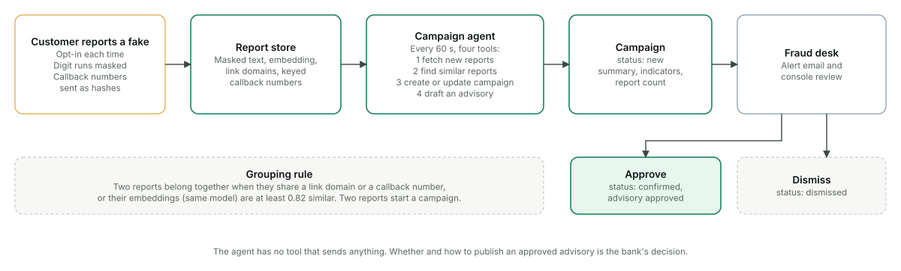</p>

<p align="center"><sub><b>Campaign detection.</b> Alert emails go to your fraud desk addresses for new and growing campaigns.</sub></p>

- `GET /v1/campaigns` lists campaigns with their indicators and drafted advisories.
- `POST /v1/campaigns/{id}/approve` or `/dismiss` records the analyst's decision.
- Approval publishes the warning to your customers' app, with one notice per device, until it expires (14 days by default) or an analyst withdraws it with `POST /v1/campaigns/{id}/withdraw`.
- To send it by SMS or WhatsApp, register each warning with `POST /v1/messages` (category `security_notice`) and send the approved text unchanged. A customer who checks it sees it confirmed; a fraudster's copy sent to anyone else is not.
- `GET /v1/metrics` returns registrations by category and verification counts, so you can measure coverage.

### How a verdict is decided

Every check passes the same gates in order. Only an exact, unexpired record for the checking number produces "Sent by your bank". Any failure is "Cannot check right now", never "genuine".

<p align="center">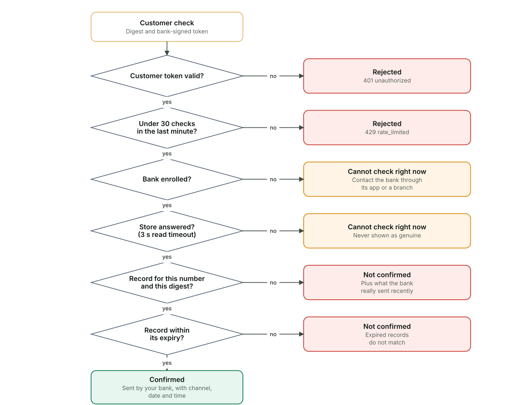</p>

<p align="center"><sub><b>Verdict gates.</b> The AI explanation runs only afterwards and cannot change the result.</sub></p>

### Security requirements

**Network**

Mutual TLS and an IP allowlist at the gateway in front of the bank-facing API.

**Clients**

One OAuth client per calling system. Secrets of at least 24 characters. Access tokens last 10 minutes.

**Keys**

One hashing key per bank, at least 32 bytes, held in your key management service, apart from the data.

**Data**

No message text, no plain numbers and no digests are stored. Only keyed hashes and descriptive fields.

**Logs**

Request bodies, query strings and authorisation headers are never logged.

**Abuse**

Customer checks are limited to 30 per minute per customer by default.

### Run it in your cloud, or ours

<p align="center">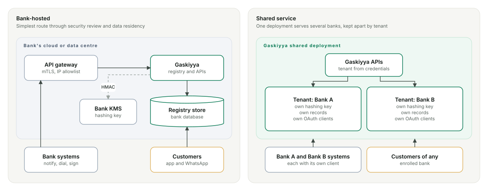</p>

<p align="center"><sub><b>Deployment options.</b> Bank-hosted is the simpler route through security review and data residency, and the likelier pilot.</sub></p>

### Bank-facing API

<details>
<summary>Show every endpoint</summary>

What your systems call. JSON bodies, ISO 8601 times with an offset, E.164 numbers. Unknown fields are rejected. Errors share one shape: `{ "code": "...", "message": "..." }`.

#### POST `/v1/oauth/token`

**Auth:** none (client credentials in the body) · **Success:** 200

Exchange your client credentials for an access token. Send it as `authorization: Bearer <access_token>` on every other bank call.

The Gaskiyya operator issues one client per system from the admin dashboard. The secret is shown once, at creation or rotation, and Gaskiyya keeps only a hash of it: store it in your secret manager straight away. Live secrets start `gsk_live_`, sandbox ones `gsk_test_`. A rotation can keep the old secret working for up to 24 hours so you can deploy without downtime; a revoked client, and every token it holds, stops working at once.

Request body

```json
{
  "grant_type": "client_credentials",
  "client_id": "notify-svc",
  "client_secret": "your-client-secret-from-onboarding"
}
```

Response

```json
{
  "access_token": "eyJhbGciOiJIUzI1NiJ9.example",
  "token_type": "Bearer",
  "expires_in": 600
}
```

#### POST `/v1/messages`

**Auth:** Bank access token · **Success:** 202 Accepted; 200 when the idempotency key was seen before

Register one outbound message. Optional header `idempotency-key` (1 to 128 characters) makes retries safe.

Request body

```json
{
  "recipient": "+2348012345678",
  "channel": "sms",
  "contentDigest": "2c0c122ad56268258bb16e6ba85fb2f9c8bab9ce1d8ff20527060f8c3151729f",
  "category": "transaction_alert",
  "hasLink": false,
  "linkDomains": [],
  "asksCallback": false,
  "sentAt": "2026-10-20T13:02:11Z"
}
```

Response

```json
{
  "recordId": "rec_5f0c2a9e1b7d4c3a8e21",
  "expiresAt": "2026-11-19T13:02:11.000Z"
}
```

Response: a one-time code while SIM-swap checks are on

For `category: "otp"` the response also says whether the number's SIM changed recently, so your gateway can hold the code. The record is registered either way. `simSwapStatus` is `swapped`, `not_swapped` or `unknown`.

```json
{
  "recordId": "rec_7b3e1d9a2c5f4e8a6b02",
  "expiresAt": "2026-11-19T13:02:11.000Z",
  "simSwapWarning": true,
  "simSwapStatus": "swapped"
}
```

#### POST `/v1/messages/batch`

**Auth:** Bank access token · **Success:** 202

Register 1 to 500 messages in one call. An idempotency key is suffixed with each message's position (`key:0`, `key:1`, ...).

Request body

```json
{
  "messages": [
    {
      "recipient": "+2348012345678",
      "channel": "sms",
      "contentDigest": "2c0c122ad56268258bb16e6ba85fb2f9c8bab9ce1d8ff20527060f8c3151729f",
      "category": "transaction_alert",
      "hasLink": false,
      "linkDomains": [],
      "asksCallback": false,
      "sentAt": "2026-10-20T13:02:11Z"
    },
    {
      "recipient": "+2348098765432",
      "channel": "sms",
      "contentDigest": "2c0c122ad56268258bb16e6ba85fb2f9c8bab9ce1d8ff20527060f8c3151729f",
      "category": "otp",
      "hasLink": false,
      "linkDomains": [],
      "asksCallback": false,
      "sentAt": "2026-10-20T13:02:11Z"
    }
  ]
}
```

Response

```json
{
  "records": [
    {
      "recordId": "rec_5f0c2a9e1b7d4c3a8e21",
      "expiresAt": "2026-11-19T13:02:11.000Z"
    },
    {
      "recordId": "rec_9a1d7e3c5b2f4a6c8d10",
      "expiresAt": "2026-11-19T13:02:11.000Z"
    }
  ]
}
```

#### POST `/v1/receipts`

**Auth:** Bank access token · **Success:** 202 Accepted; 200 when the idempotency key was seen before, or when the beneficiary bank is not enrolled (`stored: false`)

Register one completed transfer, as the paying bank. Optional header `idempotency-key`. Kept for `RECEIPT_TTL_DAYS` (30 by default).

Request body

```json
{
  "receiptDigest": "ffad1da468d0b2a9ee2b94e1078ed4e8c896e1b46a830f45474f6ed037f8bf09",
  "beneficiaryAccount": "0123456789",
  "beneficiaryBank": "999001"
}
```

Response

```json
{
  "receiptId": "rct_7c1e9a2d4b6f8a0c3e5d",
  "expiresAt": "2026-11-19T13:02:11.000Z",
  "stored": true
}
```

#### POST `/v1/receipts/batch`

**Auth:** Bank access token · **Success:** 202

Register 1 to 500 transfers in one call. An idempotency key is suffixed with each receipt's position, as for messages.

Request body

```json
{
  "receipts": [
    {
      "receiptDigest": "ffad1da468d0b2a9ee2b94e1078ed4e8c896e1b46a830f45474f6ed037f8bf09",
      "beneficiaryAccount": "0123456789",
      "beneficiaryBank": "999001"
    }
  ]
}
```

Response

```json
{
  "receipts": [
    {
      "receiptId": "rct_7c1e9a2d4b6f8a0c3e5d",
      "expiresAt": "2026-11-19T13:02:11.000Z",
      "stored": true
    }
  ]
}
```

#### POST `/v1/calls`

**Auth:** Bank access token · **Success:** 201

Open a call session before dialling. The customer's app shows the code; your agent reads the same code from `code`. `agentRef` is 1 to 64 characters.

Request body

```json
{
  "recipient": "+2348012345678",
  "purpose": "card_activation",
  "agentRef": "agent-017"
}
```

Response

```json
{
  "id": "call_8c1e4b2a9f7d3e5c6a01",
  "code": "4821",
  "status": "open",
  "expiresAt": "2026-10-20T13:05:11.000Z"
}
```

#### PATCH `/v1/calls/{id}`

**Auth:** Bank access token · **Success:** 200; 404 `not_found` for an unknown id

Mark the session `answered` (kept for up to two hours) or `ended` (closed at once, and the notice leaves the customer's phone).

Request body

```json
{
  "status": "answered"
}
```

Response

```json
{
  "id": "call_8c1e4b2a9f7d3e5c6a01",
  "status": "answered",
  "expiresAt": "2026-10-20T15:02:40.000Z",
  "code": "4821"
}
```

#### POST `/v1/sim-swap/check`

**Auth:** Bank access token · **Success:** 200 · **Rate limit:** per bank client (429 `rate_limited`)

Has this number's SIM changed in the last `maxAgeHours` (1 to 2400, default 240)? POST only, so the number never appears in a URL. When the mobile network cannot answer, or no network is connected, `status` is `unknown`: treat that as risky, never as "not swapped".

Request body

```json
{
  "phone": "+2348012345678",
  "maxAgeHours": 72
}
```

Response: swapped

```json
{
  "status": "swapped",
  "swapped": true,
  "latestSimChange": "2026-10-20T09:41:00.000Z",
  "maxAgeHours": 72,
  "checkedAt": "2026-10-20T13:02:11.000Z"
}
```

Response: not swapped

```json
{
  "status": "not_swapped",
  "swapped": false,
  "latestSimChange": null,
  "maxAgeHours": 72,
  "checkedAt": "2026-10-20T13:02:11.000Z"
}
```

Response: the network could not answer

```json
{
  "status": "unknown",
  "reason": "provider_unavailable",
  "maxAgeHours": 72,
  "checkedAt": "2026-10-20T13:02:11.000Z"
}
```

#### GET `/v1/campaigns`

**Auth:** Bank access token · **Success:** 200

Campaigns built from customer reports, with indicators, link domains and a drafted advisory. Nothing is sent to customers from here.

Response

```json
{
  "campaigns": [
    {
      "id": "cmp_3d9a",
      "tenantId": "demobank",
      "summary": "BVN restriction lure linking to demobank-restore.com",
      "indicators": [
        "urgency_or_threat",
        "non_bank_link"
      ],
      "linkDomains": [
        "demobank-restore.com"
      ],
      "callbackKeyCount": 0,
      "reportCount": 3,
      "status": "new",
      "firstSeen": "2026-10-20T09:14:00.000Z",
      "lastSeen": "2026-10-20T11:40:00.000Z",
      "advisory": {
        "text": "DemoBank will never ask you to restore your account through a link.",
        "status": "draft",
        "approvedBy": null,
        "approvedAt": null
      }
    }
  ]
}
```

#### POST `/v1/campaigns/{id}/approve`

**Auth:** Bank access token · **Success:** 200; 404 `not_found`

Approve the drafted advisory. The body names the analyst approving it; it is recorded as `approvedBy`, with your API client as `approvedByClient`. Without a name the request is refused (400). Your fraud desk receives an approval email when alert emails are set. `/dismiss` takes no body.

Approval publishes the advisory: it is listed for your customers by `GET /v1/advisories` until `advisory.expiresAt` (approval plus `ADVISORY_TTL_DAYS`, 14 by default), and each of your customers' app devices gets one notice, the first time only. The text must pass the same safety checks as every drafted advisory: one that asks for a PIN, password, card number or code, or claims anything is genuine, is refused with 422 `unsafe_advisory`. Nothing goes out by SMS; your gateway sends that.

Request body

```json
{
  "analyst": "Aisha Bello"
}
```

#### POST `/v1/campaigns/{id}/withdraw`

**Auth:** Bank access token · **Success:** 200; 404 `not_found`; 409 `not_approved`

Take an approved advisory down. It leaves every customer's app at once. The body names the analyst, recorded as `withdrawnBy`. Only an approved advisory can be withdrawn.

Request body

```json
{
  "analyst": "Aisha Bello"
}
```

#### GET `/v1/registration-alerts`

**Auth:** Bank access token · **Success:** 200

What the registration guard flagged, most recent first: a registered message whose declared link domain is not one of your domains, or registration volume far above its recent rate. Each new alert is also emailed to your alert addresses. Registrations are never blocked; confirm the traffic was yours, and if not, revoke the bank client named in `clientId`.

Response

```json
{
  "alerts": [
    {
      "id": "ral_3f9c0a1b2c3d4e5f6a7b",
      "kind": "unknown_link_domain",
      "domain": "demobank-verify.com",
      "category": "security_notice",
      "channel": "sms",
      "clientId": "demobank-notify",
      "count": 1,
      "expected": null,
      "windowMinutes": null,
      "firstSeen": "2026-10-20T10:12:00.000Z",
      "lastSeen": "2026-10-20T10:12:00.000Z"
    }
  ]
}
```

#### GET `/v1/metrics`

**Auth:** Bank access token · **Success:** 200

Counts only: registrations by category and channel, verification outcomes, link, call and licence checks, open call sessions and reports. `licenceData` gives the retrieval date, entry count and freshness of each licence list the licence check holds; `status` is `stale` once any list is older than the configured maximum age, and those answers become `cannot_check`. `coverage` compares what you registered with what customers checked: confirmed checks, the share of checks that were not confirmed (fakes, or genuine messages you did not register), and message checks by route.

Response

```json
{
  "registrations": 1240,
  "registrationsByCategory": {
    "transaction_alert": 1100,
    "otp": 140
  },
  "verifications": {
    "confirmed": 312,
    "not_confirmed": 41,
    "cannot_check": 2
  },
  "verificationsByChannel": {
    "app": 330,
    "whatsapp": 25
  },
  "links": {
    "belongs": 18,
    "not_confirmed": 9
  },
  "callChecks": {
    "calling": 12,
    "not_calling": 30
  },
  "licenceChecks": {
    "licensed": 21,
    "not_listed": 14
  },
  "openCalls": 1,
  "reports": 7,
  "simSwap": {
    "bank_swapped": 3,
    "bank_not_swapped": 410,
    "bank_unknown": 2,
    "customer_warned": 1
  },
  "registrationsByChannel": {
    "sms": 1200,
    "whatsapp": 40
  },
  "messageChecksByChannel": {
    "app": 330,
    "whatsapp": 25
  },
  "coverage": {
    "registered": 1240,
    "checked": 355,
    "confirmed": 312,
    "notConfirmed": 41,
    "cannotCheck": 2,
    "notConfirmedRate": 0.1155,
    "cannotCheckRate": 0.0056,
    "checksByChannel": { "app": 330, "whatsapp": 25 },
    "registeredByChannel": { "sms": 1200, "whatsapp": 40 }
  },
  "licenceData": {
    "status": "fresh",
    "maxAgeDays": 120,
    "sources": [
      {
        "id": "fccpc-digital-lenders",
        "regulator": "FCCPC",
        "title": "FCCPC approved digital lenders (DEON Consumer Lending Regulations 2025)",
        "url": "https://fccpc.gov.ng/registration-of-digital-money-lenders/approvals-of-dmls/",
        "publishedAt": null,
        "retrievedAt": "2026-10-20",
        "sample": false,
        "entries": 1650,
        "stale": false
      }
    ]
  }
}
```

</details>

### Customer verification API

<details>
<summary>Show every endpoint</summary>

What your mobile app calls to verify for your customers, the same API the Gaskiyya app uses. Every call carries the customer token your backend signed (see customer tokens) as `authorization: Bearer <token>`. The token names the bank and the number, so a check only ever confirms messages your bank sent to that customer.

1. Your backend signs a customer token for the logged-in customer.
1. The app computes the fingerprint of the message on the device.
1. The app calls `POST /v1/verify/message` with the digest and shows the verdict.

#### GET `/v1/banks`

**Auth:** none (public) · **Success:** 200

The banks (and other organisations) the Gaskiyya app can link to, and where each one signs its customers in. `kind` is `bank`, `agency` or `company`. `customerTokenUrl` is absolute, or a path on the registry for banks it hosts. `demoInboxUrl` is set for demo banks only.

Response

```json
{
  "banks": [
    {
      "id": "demobank",
      "name": "DemoBank",
      "kind": "bank",
      "domains": [
        "demobank.ng",
        "demobank.com"
      ],
      "customerTokenUrl": "/sim/customer-token",
      "demoInboxUrl": "/sim/inbox"
    }
  ]
}
```

#### GET `/v1/organisations`

**Auth:** none (public) · **Success:** 200

Every organisation on the registry (banks, government agencies, companies) with what it publishes as its own: domains, sender IDs, official contacts and official apps. All of it is public by nature. An organisation declares these in its tenant configuration (`kind`, `officialContacts`, `officialApps`).

Response

```json
{
  "organisations": [
    {
      "id": "demobank",
      "name": "DemoBank",
      "kind": "bank",
      "domains": [
        "demobank.ng"
      ],
      "senderIds": [
        "DemoBank"
      ],
      "officialContacts": {
        "phones": [
          "+2342019000000"
        ],
        "whatsapp": [
          "+2349060000000"
        ],
        "emails": [
          "care@demobank.ng"
        ],
        "social": [
          {
            "platform": "x",
            "handle": "DemoBankNG"
          }
        ]
      },
      "officialApps": {
        "android": [
          "ng.demobank.mobile"
        ],
        "ios": [
          "1234567890"
        ]
      },
      "customerTokenUrl": "/sim/customer-token"
    }
  ]
}
```

#### POST `{customerTokenUrl}`

**Auth:** yours: sign the customer in your own way first · **Success:** 200

Implemented by your bank, not by Gaskiyya: set its address as your tenant's `customerTokenUrl` to appear in the Gaskiyya app. After authenticating the customer, return a customer token (claims above) for their number. Never ask for a PIN, password, card number or one-time code on Gaskiyya's behalf.

Request body

```json
{
  "phone": "+2348012345678"
}
```

Response

```json
{
  "token": "eyJhbGciOiJFUzI1NiIsImtpZCI6ImJhbmstMjAyNi0xMCJ9.example",
  "expiresIn": 600
}
```

#### POST `/v1/verify/message`

**Auth:** Customer token · **Success:** 200

Check a message. Compute the fingerprint on the device and send only the digest; the text never leaves the phone. Fails closed: any error is `cannot_check`, never `confirmed`.

Request body

```json
{
  "contentDigest": "2c0c122ad56268258bb16e6ba85fb2f9c8bab9ce1d8ff20527060f8c3151729f",
  "channelHint": "sms"
}
```

Response: confirmed

```json
{
  "verdict": "confirmed",
  "channel": "sms",
  "category": "transaction_alert",
  "sentAt": "2026-10-20T13:02:11.000Z",
  "bank": "DemoBank"
}
```

```json
{
  "verdict": "not_confirmed",
  "recentActivity": [
    {
      "category": "transaction_alert",
      "channel": "sms",
      "count": 2,
      "anyWithLink": false
    }
  ],
  "activityText": "In the last 24 hours DemoBank sent you two transaction alerts by SMS. Neither contained a link.",
  "bank": "DemoBank"
}
```

```json
{
  "verdict": "cannot_check"
}
```

Response: with a SIM-swap warning

When SIM-swap checks are on and the customer's own number moved to a new SIM recently, any answer can carry `warnings: ["sim_swapped_recently"]`. A warning never changes the verdict. `sim_status_unknown` appears only on a confirmed one-time code when the network could not answer. The same field appears on `GET /v1/calls/open`.

```json
{
  "verdict": "confirmed",
  "channel": "sms",
  "category": "otp",
  "sentAt": "2026-10-20T13:02:11.000Z",
  "bank": "DemoBank",
  "warnings": ["sim_swapped_recently"]
}
```

#### POST `/v1/verify/link`

**Auth:** Customer token · **Success:** 200

Check a web address against your registered domains. `reasons` can include `shortened`, `lookalike`, `punycode`, `ip_address`, `not_http`, `not_registered`, `apk`, `fake_app` and `invalid`. `url` is up to 2048 characters. A Play Store or App Store page returns `official_app` only when its package or App Store ID exactly equals one in your `officialApps`; an APK download is never confirmed (`apk`, `fake_app`), and a store page whose name imitates yours under an unregistered ID carries `fake_app`. `app` describes the store link.

Request body

```json
{
  "url": "https://www.demo-bank.ng/app"
}
```

Response

```json
{
  "verdict": "not_confirmed",
  "host": "www.demo-bank.ng",
  "matchedDomain": null,
  "reasons": [
    "lookalike",
    "not_registered"
  ],
  "bank": "DemoBank"
}
```

Response: an official app

```json
{
  "verdict": "official_app",
  "host": "play.google.com",
  "matchedDomain": null,
  "reasons": [],
  "app": {
    "store": "play",
    "id": "ng.demobank.mobile",
    "official": true
  },
  "bank": "DemoBank"
}
```

#### POST `/v1/verify/contact`

**Auth:** Customer token · **Success:** 200; 404 `not_found` for an unknown `tenantId`; 422 `not_a_contact` when the text is not a phone number, email address, @handle or profile link

Is this number, email or account official? `contact` is what the customer pasted: a phone number (international, or local Nigerian such as `0809 555 0101`), an email address, an `@handle`, or a profile link (`wa.me/...`, `x.com/...`, `facebook.com/...`, `instagram.com/...`, `tiktok.com/@...`, `t.me/...`). With `tenantId` only that organisation is checked; without it, every organisation on the registry. `official` needs an exact match with a contact an organisation registered and names it (`as`: `phone`, `whatsapp`, `email` or `social`). Anything else is `not_official`, with `impersonation` when the handle or email carries an organisation’s name. Fails closed: `cannot_check` if the registry cannot answer. Rate limited like the other checks; the contact is never stored or logged, only counted. `official` is not `confirmed`: caller ID and display names can be faked.

Request body

```json
{
  "contact": "https://wa.me/2349060000000"
}
```

Response: official

```json
{
  "verdict": "official",
  "contact": {
    "type": "whatsapp",
    "value": "+2349060000000"
  },
  "matches": [
    {
      "id": "demobank",
      "name": "DemoBank",
      "kind": "bank",
      "as": [
        "whatsapp"
      ]
    }
  ]
}
```

Response: not official, imitating a name

```json
{
  "verdict": "not_official",
  "contact": {
    "type": "handle",
    "value": "demobank_care_desk"
  },
  "organisation": null,
  "reasons": [
    "impersonation",
    "not_registered"
  ],
  "impersonates": [
    {
      "id": "demobank",
      "name": "DemoBank",
      "kind": "bank"
    }
  ]
}
```

#### GET `/v1/official-contacts`

**Auth:** Customer token · **Success:** 200; 503 `cannot_check` when the registry cannot answer

Your organisation’s public identity, for the app’s zero-click protection: your voice and WhatsApp numbers (E.164), SMS sender IDs and web domains. The phone matches callers, dialled numbers and message senders against this list itself, so no number it sees is sent to the registry. Public configuration only. Rate limited like the other checks.

Response

```json
{
  "bankId": "demobank",
  "name": "DemoBank",
  "kind": "bank",
  "phones": [
    "+2342019000000",
    "+2349060000000"
  ],
  "senderIds": [
    "DemoBank"
  ],
  "domains": [
    "demobank.ng"
  ],
  "updatedAt": "2026-10-20T09:00:00.000Z"
}
```

#### POST `/v1/verify/indicators`

**Auth:** Customer token · **Success:** 200; 400 `invalid_request`; 503 `cannot_check` when the registry cannot answer

Scam campaign match. Up to 10 hostnames and up to 10 phone numbers the app saw in a notification or call; at least one value. Matched only against your active scam campaigns (not dismissed, advisory not withdrawn) with customer reports in the last 7 days. Numbers are compared as keyed hashes with the callback numbers in those reports; your own domains and official numbers never match. Nothing asked is stored or logged. A match is a warning, never a confirmation.

Request body

```json
{
  "domains": [
    "demobank-restore.com"
  ],
  "phones": [
    "+2348095550101"
  ]
}
```

Response

```json
{
  "matches": [
    {
      "kind": "domain",
      "value": "demobank-restore.com",
      "campaignId": "cmp_3f9a1c2b7d4e5f60",
      "reports": 3,
      "lastSeen": "2026-10-20T08:12:00.000Z"
    }
  ]
}
```

#### POST `/v1/verify/licence`

**Auth:** Customer token · **Success:** 200 · rate limited with the other checks

Is this lender licensed? Checks a firm’s name, website or Android package ID (or a Play Store link) against the licence lists published by the FCCPC (approved digital lenders) and the CBN (banks, microfinance banks, finance companies, payment service providers). Matching is exact after normalisation: case, punctuation, spacing and the words Ltd, Limited, Plc and Nigeria are ignored. `verdict` is `licensed` (with the firm, regulator, category and the list’s retrieval date), `not_listed`, or `cannot_check` when the lists are unavailable or older than the configured maximum age. There is no “fraud” verdict: the registry only knows a name is absent. A name very close to a listed one gives `not_listed` with `similarTo` naming the listed firm, as a warning, never as a match. Being listed does not confirm that a message or call comes from the firm. `query` is 2 to 200 characters and is neither stored nor logged.

Request body

```json
{
  "query": "Fair Mony"
}
```

Response

```json
{
  "verdict": "not_listed",
  "similarTo": {
    "name": "FAIR MONEY MICROFINANCE BANK",
    "regulator": "FCCPC",
    "category": "digital_lender",
    "status": "Full approval",
    "source": {
      "id": "fccpc-digital-lenders",
      "regulator": "FCCPC",
      "title": "FCCPC approved digital lenders (DEON Consumer Lending Regulations 2025)",
      "url": "https://fccpc.gov.ng/registration-of-digital-money-lenders/approvals-of-dmls/",
      "publishedAt": null,
      "retrievedAt": "2026-10-20",
      "sample": false
    }
  },
  "regulators": [
    { "name": "FCCPC", "url": "https://fccpc.gov.ng" },
    { "name": "CBN", "url": "https://www.cbn.gov.ng" },
    { "name": "SEC", "url": "https://sec.gov.ng" }
  ],
  "sources": []
}
```

#### POST `/v1/verify/screenshot`

**Auth:** Customer token · **Success:** 200 with the verify result plus `extractedText`, `sender` and `warnings` (`["unknown_sender"]` when a not-confirmed screenshot shows a sender that is not one of the bank’s sender IDs; a matching sender never confirms anything); 422 `unreadable` when no text can be read

Check a screenshot: the text is read from the image, then fingerprinted and matched exactly like a typed message. Misread text never matches approximately. Up to 8 MB of base64.

Request body

```json
{
  "imageBase64": "iVBORw0KGgoAAAANSUhEUgAAAAEAAAABCAYAAAAfFcSJAAAADUlEQVR42mP8z8BQDwAEhQGAhKmMIQAAAABJRU5ErkJggg==",
  "mediaType": "image/png"
}
```

#### POST `/v1/verify/receipt`

**Auth:** Customer token with `accts` · **Success:** 200; 403 `account_not_linked` when the account is not in the token

Has this payment really reached my account? Send the receipt digest computed on the phone (so amount and reference never leave it), or the fields for the registry to canonicalise. `verdict` is `received` (with the paying bank and when it registered the transfer), `not_confirmed` (tell the merchant to check their balance before releasing goods) or `cannot_check`. Never `received` for an account the token does not name.

Request body

```json
{
  "receiptDigest": "ffad1da468d0b2a9ee2b94e1078ed4e8c896e1b46a830f45474f6ed037f8bf09",
  "beneficiaryAccount": "0123456789"
}
```

```json
{
  "beneficiaryAccount": "0123456789",
  "amountKobo": 2500000,
  "reference": "000013261020130211123456789012",
  "valueDate": "2026-10-20"
}
```

Response: received

```json
{
  "verdict": "received",
  "bank": "DemoBank",
  "paidFrom": "PayBank",
  "registeredAt": "2026-10-20T13:02:11.000Z"
}
```

```json
{
  "verdict": "not_confirmed",
  "bank": "DemoBank"
}
```

#### GET `/v1/calls/open`

**Auth:** Customer token · **Success:** 200

Is my bank calling me? `verdict` is `calling` (with the open session and its code), `not_calling`, or `cannot_check` when the registry cannot be read. `calls` lists every open call to the number, newest first, so when two agents call one customer each agent's code is shown; `call` is the newest. A client must show "cannot check" for `cannot_check`, for any error and for any answer it cannot parse; "not calling" only for an explicit `not_calling`.

Response

```json
{
  "verdict": "calling",
  "calling": true,
  "bank": "DemoBank",
  "call": {
    "id": "call_8c1e4b2a9f7d3e5c6a01",
    "purpose": "card_activation",
    "code": "4821",
    "status": "open",
    "openedAt": "2026-10-20T13:02:11.000Z",
    "expiresAt": "2026-10-20T13:05:11.000Z"
  },
  "calls": [
    {
      "id": "call_8c1e4b2a9f7d3e5c6a01",
      "purpose": "card_activation",
      "code": "4821",
      "status": "open",
      "openedAt": "2026-10-20T13:02:11.000Z",
      "expiresAt": "2026-10-20T13:05:11.000Z"
    }
  ]
}
```

#### GET `/v1/activity`

**Auth:** Customer token · **Success:** 200

What your bank sent this number in the last 24 hours: counts and types only, never text.

Response

```json
{
  "recentActivity": [
    {
      "category": "transaction_alert",
      "channel": "sms",
      "count": 2,
      "anyWithLink": false
    }
  ],
  "activityText": "In the last 24 hours DemoBank sent you two transaction alerts by SMS. Neither contained a link.",
  "bank": "DemoBank"
}
```

#### GET `/v1/advisories`

**Auth:** Customer token · **Success:** 200; 503 `cannot_check`

Fraud warnings from the customer's bank that a named analyst approved and that have not expired or been withdrawn, newest first. The list is the same for every customer of the bank and holds nothing about the one asking. `linkDomains` are the lookalike domains the fake messages use: show them, never as tappable links. When the registry cannot be read the answer is 503, never an empty list. An open app also receives `advisory.published` and `advisory.withdrawn` on `GET /v1/events`.

Response

```json
{
  "bank": "DemoBank",
  "advisories": [
    {
      "id": "cmp_3d9a",
      "bank": "DemoBank",
      "title": "Fraud warning from DemoBank",
      "text": "DemoBank is aware of fake messages linking to demobank-restore.com that pretend to come from us. Do not click the link or call any number in these messages; check any message in the DemoBank app.",
      "approvedAt": "2026-10-20T11:45:00.000Z",
      "expiresAt": "2026-11-03T11:45:00.000Z",
      "indicators": [
        "urgency_or_threat",
        "non_bank_link"
      ],
      "linkDomains": [
        "demobank-restore.com"
      ],
      "asksCallback": false
    }
  ]
}
```

#### POST `/v1/explain`

**Auth:** Customer token · **Success:** 200

Plain-language reasons a not-confirmed message looks risky. Send masked text (runs of four or more digits replaced with `#`). It runs after the verdict and cannot change it. `language`: `en`, `pcm`, `ha`, `yo` or `ig`.

Request body

```json
{
  "maskedText": "DemoBank: your account ***#### has been restricted. Verify at demobank-restore.com within 24 hours.",
  "language": "en"
}
```

Response

```json
{
  "indicators": [
    "urgency_or_threat",
    "non_bank_link"
  ],
  "explanation": "The message threatens a restriction and links to a site that is not your bank.",
  "action": "Do not reply, click or call. If you are worried, contact your bank through its app or at a branch.",
  "source": "model"
}
```

#### POST `/v1/reports`

**Auth:** Customer token · **Success:** 201

Report a fake to your fraud desk with the customer's consent. Masked text only; callback numbers as SHA-256 digests of `tel:` plus digits.

Request body

```json
{
  "maskedText": "DemoBank: your account ***#### has been restricted. Verify at demobank-restore.com within 24 hours.",
  "consent": true,
  "indicators": [
    "urgency_or_threat",
    "non_bank_link"
  ],
  "callbackDigests": []
}
```

Response

```json
{
  "reportId": "rpt_4b8e2c1a9d7f3e5a6c02"
}
```

#### POST `/v1/devices`

**Auth:** Customer token · **Success:** 204 No Content

Register a push token so call notices reach the phone while the app is closed.

Request body

```json
{
  "pushToken": "fcm-registration-token-from-the-device",
  "platform": "android"
}
```

#### GET `/v1/events`

**Auth:** Customer token · **Success:** 200 `text/event-stream`

Server-sent events for an open app: `call.opened` and `call.closed` arrive the moment the bank announces or ends a call.

#### GET `/v1/me`

**Auth:** Customer token · **Success:** 200

Who the token names, for display, with your `bankCode` and the accounts from the token's `accts` claim (for the receipt check's account picker).

Response

```json
{
  "bank": {
    "id": "demobank",
    "name": "DemoBank",
    "domains": [
      "demobank.ng",
      "demobank.com"
    ],
    "bankCode": "999001"
  },
  "phoneLast4": "5678",
  "accounts": [
    "0123456789"
  ]
}
```

#### Errors

| Status | Code | Meaning |
| --- | --- | --- |
| 400 | `invalid_request` | Schema validation failed; the message names the fields, never their values. Unknown fields are rejected |
| 400 | `sent_at_in_future`, `sent_at_expired` | Registration only: `sentAt` is more than 5 minutes ahead of the registry's clock, or so old the record would already have expired. In a batch, the message names the index and nothing is stored |
| 401 | `unauthorized` | Missing or invalid access token (bank) or customer token (customer) |
| 401 | `invalid_client` | Unknown client or wrong secret |
| 403 | `org_suspended` | Bank calls and token requests while the operator has suspended your organisation. Your customers' checks answer `cannot_check` meanwhile, never confirmed |
| 403 | `feature_disabled` | That feature (messages, calls, receipts, SIM swap or advisories) is not switched on for your organisation |
| 403 | `account_not_linked` | Receipt check only: the account is not in the customer token's `accts` claim |
| 404 | `not_found` | No such call session or campaign |
| 413 | `too_large` | Body over 12 MB |
| 422 | `unreadable` | No message text could be read from a screenshot |
| 429 | `rate_limited` | More than 30 checks a minute for one customer (message, link, screenshot, receipt and explain), or, for bank calls, more than the per-minute limit the operator set for your organisation |

</details>

### Onboarding checklist

1. Data protection review under the NDPA, and data processing terms (DPO and legal)
1. Choose bank-hosted or shared deployment (Architecture)
1. Organisation record: id, display and legal name, NIBSS code, official domains, sender IDs, official contacts and apps, JWKS URL, sign-in URL, fraud desk emails, technical contact. The operator enters it in the admin dashboard, starting in sandbox (Bank and operator)
1. Per-bank hashing key of at least 32 bytes: made by the dashboard and stored encrypted, or in your KMS when you host the registry (Security)
1. OAuth client per system, mTLS certificates, IP allowlist (Security and operator)
1. Your fingerprint code passes every shared test vector (Engineering)
1. Registration live for the first message type (Notification team)
1. Call announcement in the dialler, code panel for agents (Contact centre)
1. Customer token signing and JWKS published (Mobile backend)
1. Fraud desk trained on the console; test alert email received (Fraud team)

## Questions

**Does Gaskiyya read my SMS inbox?**
No. You choose what to check by pasting, sharing or taking a screenshot. The app never reads your messages on its own.

**Why might a real message show as "not confirmed"?**
Only messages your bank has registered with Gaskiyya can be confirmed. Banks enrol one message type at a time, so treat "not confirmed" as a reason to be careful, and contact your bank through its app or a branch.

**Can a fraudster make a fake message pass?**
Not by copying it. A confirmation needs an exact match with a record your bank created for your number. Change one character, or send it to someone else, and it won't match.

**Does AI decide whether a message is genuine?**
Never. The answer comes only from your bank's records. AI is used afterwards, only to explain in plain words why something looks risky.

**Will Gaskiyya ever ask for my PIN or a one-time code?**
Never. If anyone claiming to be Gaskiyya or your bank asks for your PIN, password, card number or a one-time code, it's a scam.

**Is Gaskiyya an app or a service for banks?**
Both, in that order. Gaskiyya is verification infrastructure that banks connect to their messaging and contact centre. Customers then check messages and calls in their bank's own app, or in the Gaskiyya app.

**Does it work with my bank?**
Only if your bank uses Gaskiyya. A message can be confirmed only when the bank registered it, so the app links your number through your bank's own login. If your bank is not on Gaskiyya yet, the app cannot confirm its messages. Ask your bank to join.

## Development

This repository holds the registry API (`packages/api`), the Gaskiyya app (`mobile/`), the landing page and bank guide (`site/`), the bank sandbox console and phone emulator (`console/`), the admin dashboard (`admin/`) and the docs (`docs/`). Shared code lives in `packages/`. The bank SDK lives in its own repository, [gaskiyya/gaskiyya-sdk](https://github.com/gaskiyya/gaskiyya-sdk).

Needs Node 22 and pnpm. The app needs Flutter.

```sh
pnpm install
pnpm start          # registry, console and admin on :8080, with the demo bank
pnpm dev            # site on :5175
pnpm dev:sandbox    # console running the api in the browser, on :5173
pnpm dev:console    # console against the api on :8080
pnpm dev:admin      # admin dashboard on :5172
pnpm build          # typecheck, then build every UI into dist/
pnpm test           # TypeScript, Dart and Flutter tests
```

Run the app against your local registry with the command `pnpm start` prints:

```sh
cd mobile && flutter run --dart-define=API_URL=http://<your computer's address>:8080
```

`docs/DEMO.md` walks through a full demo, and `docs/CONFIGURATION.md` explains every setting.
