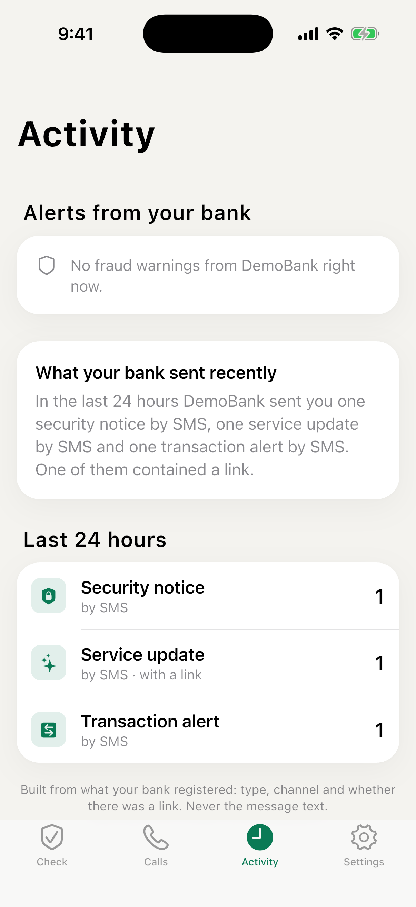

<p align="center">
  <picture>
    <source media="(prefers-color-scheme: dark)" srcset="brand/gaskiya-logo-dark.svg">
    
  </picture>
</p>

<h1 align="center">Gaskiyya</h1>

<p align="center">
  <picture>
    <source media="(prefers-color-scheme: dark)" srcset="brand/tagline-dark.svg">
    
  </picture>
</p>

<p align="center">Gaskiyya lets customers check any SMS, link or call against their bank's own records in seconds.<br>One API call when the bank sends. Nothing changes in its messages.</p>

<p align="center"><a href="https://gaskiyya-io.web.app/"><strong>View the live site</strong></a></p>

<p align="center">
  <a href="https://gaskiyya-io.web.app/console/">DemoBank simulation</a> ·
  <a href="https://gaskiyya-io.web.app/banks.html">Integration guide</a> ·
  <a href="https://github.com/gaskiyya/gaskiyya-sdk">Bank SDK</a> ·
  <a href="https://gaskiyya-io.web.app/gaskiyya-whitepaper.pdf">Whitepaper (PDF)</a>
</p>

<div align="center">

<table>
  <tr>
    <td align="center"><br><sub>Check a message</sub></td>
    <td align="center"><br><sub>Sent by your bank</sub></td>
    <td align="center"><br><sub>Not confirmed</sub></td>
  </tr>
  <tr>
    <td align="center"><br><sub>Check a link</sub></td>
    <td align="center"><br><sub>Know who is calling</sub></td>
    <td align="center"><br><sub>See what your bank really sent</sub></td>
  </tr>
</table>

</div>

## Try it as DemoBank

Open the DemoBank simulation at **[gaskiyya-io.web.app/console](https://gaskiyya-io.web.app/console/)**. You play the bank on the left, and a customer's phone sits on the right, with the Gaskiyya app on it. Everything runs in your browser with the registry's own code, so nothing is sent anywhere, and reloading the page starts fresh.

<p align="center"></p>

What you can try:

- **Messages.** Send a genuine alert, then a tampered copy or a fake. Open Gaskiyya on the phone, sign in as Amina, and check each one.
- **Calls.** Announce a call and watch the same four-digit code appear on the agent screen and the phone. Then let a fraudster call from the bank's number, and see Gaskiyya say the bank isn't calling.
- **SIM swap.** Move a customer's number to a new SIM and see the bank hold the one-time code.
- **Transfers.** Pay a merchant, then check the receipt, a changed amount and a made-up one.
- **Fraud desk.** Simulate customer reports, run the agent and approve the advisory it drafts.
- **USSD, contacts and licences.** Use the feature phone menu, check a fake customer care number, and ask whether a lender is licensed.

## The problem

A fake looks exactly like the real thing. Fraudsters copy a bank's wording, its sender name and its tone. Often the only difference is a single character.

| Your bank | A fraudster |
| --- | --- |
| `www.demobank.ng/app` | `www.demo-bank.ng/app` |

Customers can't be expected to spot that. The bank's own records can, once every message is registered with Gaskiyya.

## How customers check

One question, a straight answer. Customers check inside their bank's own app through the Gaskiyya API, or in the Gaskiyya app. Either way, the answer comes from the bank's records.

1. **Paste it, share it, or snap it.** Copy a suspicious SMS or WhatsApp message, share it straight from your messages app, paste a link, or send a screenshot.
2. **Fingerprinted on your phone.** Gaskiyya turns the message into a fingerprint on your phone. Only the fingerprint decides the result, never your words. To explain a result that is not confirmed, the text is sent once with long numbers hidden.
3. **Your bank's records answer.** If your bank sent that exact message to your number, you'll see *Sent by your bank*, with the channel, date and time.
4. **Not on record? You'll know why.** You'll see what your bank really sent you recently, and plain-language reasons the message looks like a scam.

Change one character and the check fails. Extra spaces don't matter. A changed letter, digit or dot does. The check is also tied to your phone number, so a real message forwarded to someone else will not verify for them.

## Calls

A code only your bank can read to you. Caller ID can be faked. This can't. When your bank calls, Gaskiyya shows you a four-digit code at the same moment it appears on the agent's screen. If the caller can't read it, hang up.

- The notice arrives the instant the bank dials.
- The code expires after three minutes.
- No call on record? Gaskiyya tells you the bank isn't calling.

## The app

- **Check any link.** Lookalike addresses, shortened links and disguised characters are caught. Only your bank's registered domains pass.
- **Know why it's fake.** Plain-language reasons, from urgent threats to links that aren't your bank's.
- **Never asks for secrets.** No PIN, password, card number or one-time code. Ever. If something asks, it isn't us.
- **See what your bank really sent.** Your bank's recent messages to you, at a glance. Counts and types only, never the text.
- **Easy to read, day or night.** Follows your phone's light or dark setting.
- **Know who is calling.** When your bank calls, the app says so. When it isn't calling, the app says that too.

## Privacy

Built so there's nothing to leak.

- **Your words stay on your phone.** Messages are fingerprinted on your device. The text is never sent or stored.
- **No phone numbers stored.** Records hold scrambled keys only. Even a breach reveals no numbers and no messages.
- **Only your bank confirms.** An answer of "sent by your bank" comes from an exact match in your bank's records, never from a guess or an AI.
- **When in doubt, it says so.** If a check can't be completed, you're told plainly. Gaskiyya never guesses "genuine".

## For banks

One API call. Fewer customers fooled.

Register a fingerprint when you send. Announce calls before you dial. Customers verify in your app through the Gaskiyya API, or in the Gaskiyya app. No access to core banking, accounts or transactions. Run it in your own cloud, or ours.

1. **Register as you send.** One call per message, with the fingerprint of its final text.

   ```http
   POST /v1/messages
   { "recipient": "+234801...", "contentDigest": "3f37d7...", "category": "transaction_alert" }
   ```

2. **Announce outbound calls.** Your dialler opens a session, and the agent reads the four-digit code from their screen.
3. **See campaigns as they start.** Customer reports are grouped into scam campaigns with a drafted advisory, sent to your fraud desk by email.

The quickest way to connect is the Node.js SDK, which has its own repository: [gaskiyya/gaskiyya-sdk](https://github.com/gaskiyya/gaskiyya-sdk). It gets the access token, works out fingerprints the same way the registry does, and retries safely.

```ts
import { Gaskiyya } from '@gaskiyya/bank-sdk';

const gaskiyya = Gaskiyya.fromEnv();

await gaskiyya.messages.register({
  recipient: '+2348012345678',
  text: smsText,
  category: 'transaction_alert',
});

const call = await gaskiyya.calls.open({
  recipient: '+2348012345678',
  purpose: 'fraud_check',
  agentRef: 'agent-017',
});
```

The [integration guide](https://gaskiyya-io.web.app/banks.html) covers every endpoint, the fingerprint rules, customer tokens, security requirements and the onboarding checklist. To see it all from the bank's side first, [try it as DemoBank](#try-it-as-demobank).

## Questions

**Does Gaskiyya read my SMS inbox?**
No. You choose what to check by pasting, sharing or taking a screenshot. The app never reads your messages on its own.

**Why might a real message show as "not confirmed"?**
Only messages your bank has registered with Gaskiyya can be confirmed. Banks enrol one message type at a time, so treat "not confirmed" as a reason to be careful, and contact your bank through its app or a branch.

**Can a fraudster make a fake message pass?**
Not by copying it. A confirmation needs an exact match with a record your bank created for your number. Change one character, or send it to someone else, and it won't match.

**Does AI decide whether a message is genuine?**
Never. The answer comes only from your bank's records. AI is used afterwards, only to explain in plain words why something looks risky.

**Will Gaskiyya ever ask for my PIN or a one-time code?**
Never. If anyone claiming to be Gaskiyya or your bank asks for your PIN, password, card number or a one-time code, it's a scam.

**Is Gaskiyya an app or a service for banks?**
Both, in that order. Gaskiyya is verification infrastructure that banks connect to their messaging and contact centre. Customers then check messages and calls in their bank's own app, or in the Gaskiyya app.

**Does it work with my bank?**
Only if your bank uses Gaskiyya. A message can be confirmed only when the bank registered it, so the app links your number through your bank's own login. If your bank is not on Gaskiyya yet, the app cannot confirm its messages. Ask your bank to join.

## Development

This repository holds the registry API (`packages/api`), the Gaskiyya app (`mobile/`), the landing page and bank guide (`site/`), the bank sandbox console and phone emulator (`console/`), the admin dashboard (`admin/`) and the docs (`docs/`). Shared code lives in `packages/`. The bank SDK lives in its own repository, [gaskiyya/gaskiyya-sdk](https://github.com/gaskiyya/gaskiyya-sdk).

Needs Node 22 and pnpm. The app needs Flutter.

```sh
pnpm install
pnpm start          # registry, console and admin on :8080, with the demo bank
pnpm dev            # site on :5175
pnpm dev:sandbox    # console running the api in the browser, on :5173
pnpm dev:console    # console against the api on :8080
pnpm dev:admin      # admin dashboard on :5172
pnpm build          # typecheck, then build every UI into dist/
pnpm test           # TypeScript, Dart and Flutter tests
```

Run the app against your local registry with the command `pnpm start` prints:

```sh
cd mobile && flutter run --dart-define=API_URL=http://<your computer's address>:8080
```

`docs/DEMO.md` walks through a full demo, and `docs/CONFIGURATION.md` explains every setting.
